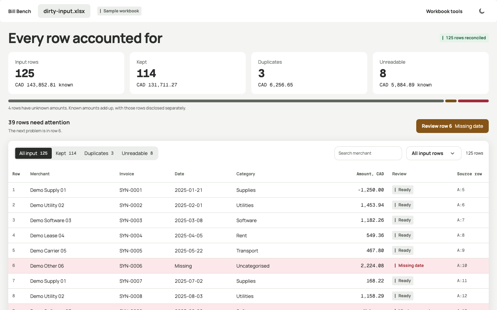
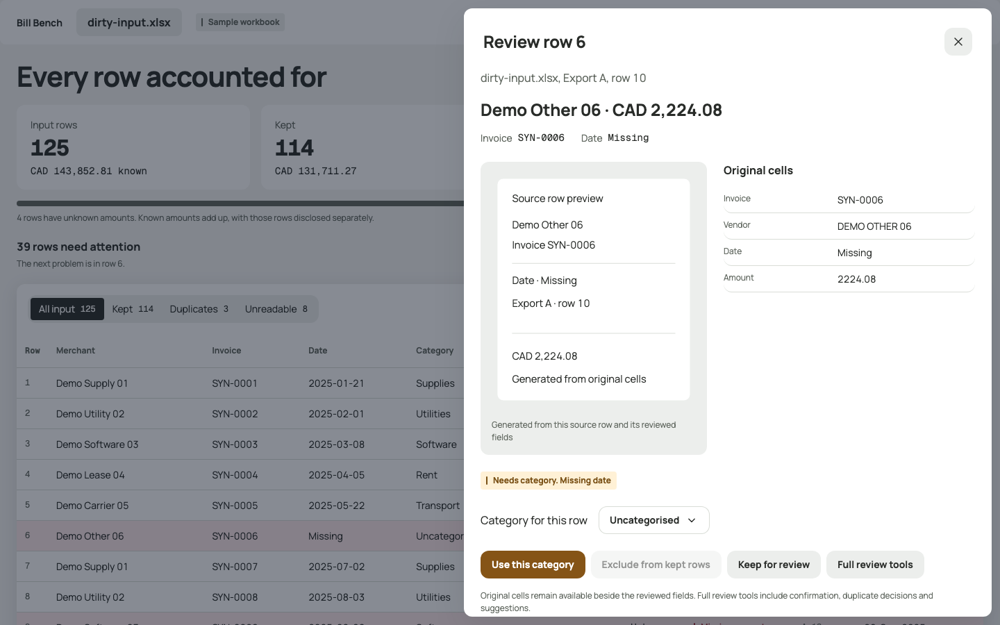
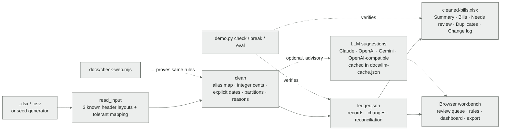

# Bill Bench

**Clean and reconcile CSV/XLSX bills, with a source row behind every retained amount.**

For people reviewing inconsistent bill exports: normalise merchants, separate exact duplicates and send uncertain rows to a review queue before exporting a five-sheet workbook. A merchant you classified once does not need another model call or another manual category decision for each monthly export.

**[Try the live demo](https://nickkklian.github.io/bill-categoriser/?demo=1)** · [Open the sample workbook](output/cleaned-bills.xlsx) · [Inspect its ledger](output/ledger.json)

The bundled sample is synthetic: **125 input rows = 114 retained + 3 exact duplicates + 8 unparseable**, and every value links back to its source sheet and row.

[](https://nickkklian.github.io/bill-categoriser/?demo=1)

## Quick start

Use the browser demo with no account or key, or run the offline Python CLI (Python 3.9+, standard library only). This cleans the included January example with a reviewed rules file and checks the result:

```sh
git clone https://github.com/NickkkLian/bill-categoriser.git
cd bill-categoriser
python3 -B demo.py clean examples/january.csv --rules examples/rules.json --out output-january --verify
```

To clean your own exports, run `python3 -B demo.py clean bills.csv another-export.xlsx --out output-clean --verify`. This writes the output and runs the existing checker with the same threshold in one command; verification failure returns a nonzero exit status. Keep the original files unchanged for verification. The rules support CAD and explicit dates; unknown merchants require review. The default workflow processes files locally; selecting your own model provider sends a suggestion request to that provider.

## Try it

**In the browser** — open the [live demo](https://nickkklian.github.io/bill-categoriser/?demo=1), or serve the local folder with `python3 -m http.server -d docs` and open http://localhost:8000. The page starts with the 125 generated sample rows or restores your saved workbook. **Workbook tools** provides Import, Bills, Needs review, Duplicates, Rules, Change log, Dashboard and Export. Import accepts a dropped `.xlsx` or `.csv` file and parses it locally. The site assets and fonts are self-hosted.

**From the command line** — no packages, accounts or network access are needed.

```sh
python3 -B demo.py build
python3 -B demo.py check
```

`build` writes `output/dirty-input.xlsx`, `output/ledger.json` and `output/cleaned-bills.xlsx`; `check` verifies them (the delivered files are already built, so you can open [the workbook](output/cleaned-bills.xlsx) first). On Windows use `python` if that is your Python command.

`clean <files...>` reads your exports in argument order and writes `ledger.json` and the same five-sheet `cleaned-bills.xlsx`, with monthly totals for the months present in your retained bills. It defaults to `output-clean/` in your current directory. By default it uses the existing exact merchant rules: a merchant outside the alias map stays `Uncategorised` for review. Add `--rules rules.json` to reuse aliases and the threshold exported from the browser. It makes no model calls. Use `--high-cad` on both `clean` and `check` to change the review threshold. `check` re-reads the original input paths recorded in the ledger, checks every output cell/formula and rebuilds twice; keep those files available and unchanged. Absolute source paths are recorded for traceability, including when two files share a name. The output cannot overwrite an input or the generated demo folder.

| Seed 42 result | Rows | Known amount (CAD) |
| --- | ---: | ---: |
| Retained in Bills | 114 | 131,711.27 |
| Exact duplicates excluded | 3 | 6,256.65 |
| Unable to parse completely | 8 | 5,884.89 |
| All input rows | 125 | 143,852.81 |

Four input amounts are unknown; they are kept out of the arithmetic, never treated as zero. `131,711.27 + 6,256.65 + 5,884.89 = 143,852.81` is asserted by `check`, by the browser's own checks card, and by the workbook's reconciliation formula.

### Reuse reviewed rules next month

In the browser's **Rules & thresholds** view, choose **Export rules JSON** after applying your reviewed aliases. `clean --rules FILE` accepts that exact `aliases` / `high_cad` schema, so a merchant you classified once does not need another model call or another manual category decision for each monthly export. Matching remains exact after the same normalisation used by the browser.

Try the included synthetic two-month example:

```sh
python3 -B demo.py clean examples/january.csv --rules examples/rules.json --out output-january --verify
python3 -B demo.py clean examples/february.csv --rules examples/rules.json --out output-february --verify
python3 -B demo.py check --out output-february --rules examples/rules.json
```

The rules file sets the threshold, so there is no second `--high-cad` to remember. Categories are Supplies, Utilities, Software, Rent, Transport and Uncategorised. New merchants without an exact rule still require review.

The ledger stores a rules snapshot. Later `check --out output-february` uses that snapshot and can reproduce the result even if the original rules file moved; `check --rules FILE` additionally checks that the policy you supplied matches the snapshot.

## What the browser version adds



- **Overview** — a reconciliation panel that shows where every input row went, partition cards and a searchable, sortable source ledger. Selecting a row opens its original cells and a generated source-row preview. The full review queue retains workload filters, and Export runs the six in-tab checks.
- **Bills / Change log** — both tables sort by their column headers and filter from one row above them; **Duplicates** shows each excluded or possible duplicate next to the row it repeats. Every value carries a provenance chip (`src A:6`) that links back to the source sheet and row; 1,004 build-time changes plus your own decisions are logged with the rule that caused them.
- **Needs review** — a keyboard-driven queue (`j`/`k`, `a` confirm, `c` category, `d` duplicate, `x` exclude, `u` undo). Every decision is undoable and written to the change log; "also add rule" turns one decision into a rule and shows how many rows it affects first.
- **Rules** — alias → category rules and the high-amount threshold; edits show their impact (rows re-categorised, flagged, un-flagged) before you apply them.
- **Suggestions** for unmapped merchants: *cached model output* shipped in the repo (model and date shown, selected by default because it needs no key and no network), *Simulate* (canned keyword rules, no network, labelled simulated), or *your own model* — Claude, OpenAI, Google Gemini or any OpenAI-compatible endpoint such as Ollama (the key is kept in the tab's memory, never stored, and is cleared when you pick another provider). Suggestions only ever enter the review queue; accepting one is recorded as your decision.
- **Export** — the same five-sheet workbook, `ledger.json` and `rules.json`, built in the browser with the same OOXML writer the CLI uses. A zero-decision export of the sample is byte-identical to the CLI's `ledger.json`, and `demo.py check` accepts a browser-built folder.
- One header icon switches the approved palette between light and dark. Keyboard settings remain in Workbook tools. URL state, IndexedDB persistence and the Import page's "Clear all data" action remain available.

## How it fits together



`demo.py` and `docs/bills-engine.js` are two implementations of the same rules. `docs/check-web.mjs` proves they agree: the Python-compatible random stream (six seeds × 2,000 draws), the generated rows, the ledger bytes for three seeds, every cell and formula of the five sheets, XLSX reading (stored and deflate-compressed members), and finally `python3 -B demo.py check` accepting a folder the JavaScript engine built — with a negative control that removes one row and must be rejected. It runs in CI on every push.

## Rules and trade-offs

1. `generate(seed)` creates 120 base records, three exact copies and two possible duplicates across three sheets, with mixed headers, date formats, merchant aliases, currency symbols, thousands separators, refunds, zero, missing fields and malformed fields.
2. Amounts are integer cents. Supported amounts are CAD; dates accept only explicit year-first formats or a named month. `03/04/2025` is rejected because the source does not define a day/month order.
3. Merchant classification is an exact alias map. Unknown merchants become `Uncategorised` and require review. The optional LLM step never changes that: it produces suggestions, and a person accepts or dismisses each one.
4. An exact duplicate needs invoice ID, normalised merchant, date and cents to match. A different invoice ID with the same merchant, date and cents is retained and flagged as a possible duplicate. Fuzzy matching is deliberately not attempted.
5. A source row belongs to exactly one of `clean`, `duplicate` or `unparseable`. `clean` means structurally parseable, not approved for posting. Missing dates still contribute their known amounts to the control total. In the browser, a reviewer can additionally mark a row `excluded`; the export then adds an "Excluded by reviewer" line so the control total still reconciles.
6. Formula-like merchant text is stored as a literal string and never becomes an executable Excel formula. Input cells containing actual formulas are rejected.
7. The workbook is produced by filling bundled, pre-formatted XLSX templates with a small standard-library OOXML reader/writer; the writer uses stored ZIP members and fixed metadata so rebuilds are byte-for-byte identical.

### Review workload in this sample

Seed 42 with the default threshold flags **39 of 125 rows (31.2%)**: 20 unmapped merchants, 10 high amounts, 3 exact duplicates, 2 possible duplicates, 2 missing dates, 2 missing amounts, 2 invalid amounts, 1 invalid date and 1 ambiguous date (a row can carry more than one reason). The sample deliberately spreads amounts across CAD 12 to 2,800 with explicit edge cases; it is a stress sample, not a measured bill distribution. Change the high-amount threshold with `--high-cad AMOUNT` at build time (and pass the same value to `check`); the browser has the same control on the Rules page.

## The optional model step

`python3 -B demo.py build --llm` asks a model about each `Uncategorised` merchant and writes `output/llm-suggestions.json` with `category / confidence / reason`. Answers are cached in `docs/llm-cache.json`, and that cache ships with the repository, so later builds and the browser page work offline and need no key. Suggestions only ever enter the review queue; the ledger and workbook never change on their own.

The model is your choice. Claude is the default, not a requirement:

```sh
ANTHROPIC_API_KEY=... python3 -B demo.py build --llm                                    # Claude, claude-sonnet-5-5
LLM_PROVIDER=openai OPENAI_API_KEY=... LLM_MODEL=your-model-id python3 -B demo.py build --llm
LLM_PROVIDER=gemini GEMINI_API_KEY=... LLM_MODEL=your-model-id python3 -B demo.py build --llm
LLM_PROVIDER=openai-compatible LLM_BASE_URL=http://localhost:11434/v1 LLM_MODEL=your-model-id python3 -B demo.py build --llm   # Ollama, LM Studio, vLLM…
LLM_PROVIDER=chatgpt LLM_MODEL=your-model-id python3 -B demo.py build --llm             # your ChatGPT plan (not yet tried live), see DOCS.md
```

On the 30-merchant evaluation set the cached Claude run (`claude-sonnet-5`, 2026-09-22) scored 30 of 30, against 19 of 30 for a keyword list. Request formats, what has been run against each live service, and the ChatGPT-plan sign-in are in [DOCS.md](DOCS.md#the-optional-llm-step).

## Supported layouts

`build` and the browser's strict mode use the demo layout: three sheets named `Export A / B / C` whose fourth row holds one of the three known header sets (`Invoice / Vendor / Date / Amount`, `Bill ID / Merchant name / Invoice date / Total CAD`, `Reference / Payee / Billed on / Gross amount`).

`clean` accepts UTF-8 CSV (with or without BOM; comma, semicolon or tab delimiters) and XLSX with arbitrary sheet names and column order. It looks in the first five rows of each nonempty sheet for one unambiguous column per field. Header aliases ignore case, spaces and punctuation:

| Field | Accepted headers |
| --- | --- |
| Invoice | Invoice, Invoice ID, Invoice number, Bill ID, Bill number, Reference |
| Merchant | Vendor, Vendor name, Merchant, Merchant name, Payee |
| Date | Date, Invoice date, Bill date, Billed on, Transaction date |
| CAD amount | Amount, Amount CAD, Total, Total CAD, Total amount, Gross amount |

Additional labelled metadata columns are ignored; data beyond the header width is rejected. Empty rows/sheets are skipped. A nonempty sheet without a matching header, ambiguous columns or actual formula cells stops the import before writing outputs. CSV source rows count logical records, so quoted multiline fields stay together. Numeric Excel amounts are accepted to the cent without rounding extra precision. Other parsing boundaries stay the same: explicit text dates only, CAD only, no Excel serial dates, PDFs, macros or guessed slash-date order. Unsupported dates/amounts stay unparseable with their original values in the review queue.

The browser's tolerant mapping remains separate: it searches header words in the first five rows and reports matches. The existing synthetic parity checks still cover the shared cleaning rules and sample workbook; they do not prove every uploaded layout has identical mapping in both interfaces.

## Checks

The command line was tested on macOS 15.7 with Python 3.9, 3.12 and 3.13.

```sh
python3 -B demo.py check
python3 -B demo.py break
python3 -B demo.py eval
```

`check` verifies source identities, disjoint partitions, known amounts, every output cell and formula, review and change-log contents, parsing boundaries, repeatability (two rebuilds must match the delivered files byte for byte) and, new in this version, that the LLM cache is well-formed and that any suggestions file is purely advisory.

`break` runs three mutations in disposable copies and requires the real checker to reject each: a deleted Bills row, a changed threshold default that produces 92 review rows instead of 39, and a cache entry with a category outside the allowed set. It exits 0 only after observing all three failures; your delivered files stay intact.

`eval` scores the optional LLM categoriser on `eval/merchants.json`: 30 synthetic merchant names, 20 that carry an obvious keyword and 10 that need inference. It prints the keyword baseline next to the cached model output and passes at 80% accuracy. Both have been run: 2026-09-22, `claude-sonnet-5`, **30 of 30**, against a keyword baseline of **19 of 30**. The default is now `claude-sonnet-5-5`, which has not been scored on this set.

For another synthetic dataset:

```sh
python3 -B demo.py build --seed 17 --out output-seed-17
python3 -B demo.py check --out output-seed-17
```

To use a different high-amount threshold, keep the build and check arguments together:

```sh
python3 -B demo.py build --high-cad 2000 --out output-high-2000
python3 -B demo.py check --high-cad 2000 --out output-high-2000
```

The web engine's parity check needs Node 22 (for `DecompressionStream('deflate-raw')`) and Python:

```sh
node docs/check-web.mjs
```

## Where this is not suitable

This is not a general Excel migration tool and not an accounting system. It does not support arbitrary workbooks beyond the header mapping above, OCR/PDF invoices, macros, tax treatment, exchange-rate conversion or posting to accounting software. Review the workbook before using a result in another system.

Reusing a rules file is a reproducibility check against the recorded policy, not proof that the policy was the right human decision. Keep the original CSV/XLSX inputs unchanged. This feature reuses exported alias rules for new CLI runs; it does not import the browser's individual review decisions or make a manually reviewed browser ledger pass the CLI checker.

**Not verified here:** native Windows and Linux runs of the checker (only macOS was run locally; CI covers Ubuntu, Windows and macOS on Python 3.9 and 3.13 — see the Actions tab); browser exports that include reviewer decisions or rules cannot be checked by `demo.py check`, only zero-decision exports can; the LLM step has been run and `docs/llm-cache.json` is the whole of what that run left behind — the file records the provider, model and date, and nothing in this repository shows that a request went over the network, so a hand-written cache would be indistinguishable from this one; the tolerant header mapping was tested on synthetic files only; the checker shares some rules with the producer, so independent review remains useful.

The CLI intake tests use separate file layouts and policy assertions (`python3 -B -m unittest discover -s tests -p test_clean.py -v`). A private generator and ground truth can be kept outside this repository and used to score `clean` without exposing truth to the cleaner. Passing synthetic fixtures is not evidence of beating a plain model; no new model comparison is claimed here.

## Repository layout

```
demo.py                 CLI: clean <files...> / build / check / break / eval (Python 3.9+, standard library only)
xlsx_io.py              minimal OOXML reader and template filler
llm.py                  the CLI's model adapter: Claude, OpenAI, Gemini, OpenAI-compatible, ChatGPT plan
chatgpt_auth.py         Continue with ChatGPT: sign-in, token storage and refresh, Responses stream
templates/              pre-formatted input and output workbook templates
output/                 delivered artefacts for seed 42 (input, ledger, workbook, LLM suggestions)
eval/merchants.json     30 synthetic merchants → expected category
docs/index.html         the browser app (GitHub Pages root)
docs/bills-engine.js    the rules, ported one for one from demo.py
docs/check-web.mjs      Node harness proving the port equals the CLI
docs/templates.js       the two templates as base64, so the page works offline
docs/design-tokens.css  shared design tokens (light and dark)
```

MIT licensed. Copyright 2026 Nick Lian.
